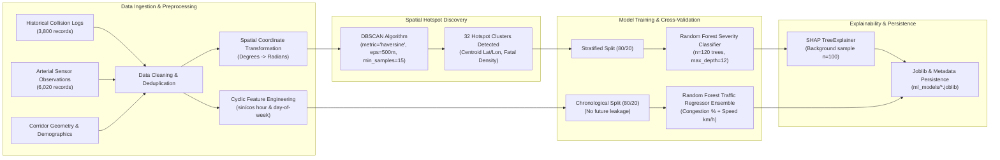

# UrbanFlow: Smart City Traffic & Road Accident Hotspot Intelligence System

> **A production-grade urban spatial analytics and machine learning platform predicting road accident vulnerability, discovering collision hotspots via spatial clustering, and forecasting arterial congestion across metropolitan road networks.**

[](https://fastapi.tiangolo.com)
[](https://react.dev)
[](https://www.typescriptlang.org)
[](https://scikit-learn.org)
[](https://shap.readthedocs.io)
[](https://postgis.net)
[](https://tailwindcss.com)
[](https://leafletjs.com)

---

## 1. Project Overview & Problem Statement

Urban centers face rapid motorization, arterial traffic gridlocks, and severe road collision casualties. In the Mumbai Metropolitan Region (MMR) alone, over 25,000 traffic incidents occur annually across critical expressways (Western Express Highway, Eastern Express Highway, Sion-Panvel Highway) and arterial junctions. 

Traditional municipal traffic management is predominantly **reactive** — responding after collisions happen or relying on delayed static police reports. **UrbanFlow** bridges this critical gap by providing a proactive, geospatial intelligence platform designed for municipal planning bodies, road transport authorities, and urban researchers.

UrbanFlow aggregates historical collision logs, sensor telemetry, infrastructure topologies, meteorological observations, and demographic density to:
1. **Identify spatial collision hotspots** using density-based spatial clustering (DBSCAN) with spherical Haversine metrics.
2. **Predict multi-class accident severity and risk scores** through a Random Forest Classifier explainable via SHAP (SHapley Additive exPlanations).
3. **Forecast arterial congestion indices and travel speeds** using diurnal time-series regressions without temporal data leakage.
4. **Deliver an enterprise-grade command center** styled for smart city traffic operations with interactive Dark Matter Leaflet maps and Recharts telemetry.

*Disclaimer: UrbanFlow is intended for exploratory analytics, urban infrastructure planning, and municipal resource allocation, not real-time emergency dispatch.*

---

## 2. Key Features

- **Executive Telemetry Dashboard**: Real-time calculated KPIs (total collisions, casualty counts, monthly trend rates, arterial congestion gauges, and live corridor speeds).
- **Interactive Accident Hotspot GIS Map**: Full-screen Leaflet map with Dark Matter tiles, 500m DBSCAN cluster halos, color-coded severity markers (Fatal, Serious, Slight), and multidimensional filters (severity, Mumbai zones, peak hours, weather).
- **Traffic Congestion & Velocity Forecaster**: Diurnal 24-hour predictive curves modeling congestion % and flow speed km/h across major Mumbai highways (WEH, EEH, Sion-Panvel, Palm Beach Road, Ghodbunder Road).
- **Explainable Accident Risk Inference (SHAP XAI)**: Live inference form predicting composite risk scores (0–100) with a local SHAP waterfall attribution chart identifying protective vs vulnerability factors.
- **Deep Multi-Variable Analytics**: 24-hour diurnal volume analysis, weekend surge comparisons, monsoon weather vulnerability regressions, and demographic per-capita collision ratios.
- **Urban Dataset Management & Governance**: Ingestion engine with automated CSV validation, column schema inspection, duplicate detection, and null-value audits.
- **Model Registry & Governance**: Real-time inspection of active model versions, confusion matrices, F1-scores, R², MAE, and Gini feature importance rankings.

---

## 3. Technology Stack

### Frontend
- **Framework**: React 19 + TypeScript (Vite 8 build toolchain)
- **Styling**: Tailwind CSS v4 + PostCSS
- **Mapping & GIS**: Leaflet.js with CartoDB Dark Matter tile basemaps
- **Data Visualizations**: Recharts (diurnal area curves, dual-axis line charts, donuts, horizontal bar charts)
- **Iconography**: Lucide React

### Backend
- **Framework**: Python 3.12+ / 3.14 / FastAPI (Asynchronous REST API)
- **Validation**: Pydantic v2
- **Database ORM**: SQLAlchemy 2.0 with connection pooling
- **Testing**: Pytest & Starlette TestClient (8/8 automated test suite)

### Machine Learning & Data Science
- **Spatial Clustering**: Scikit-Learn DBSCAN (Haversine spherical distance metric, $\varepsilon = 500\text{m}$, $\text{min\_samples} = 15$)
- **Severity Classifier**: Random Forest Classifier ($n=120$ trees, depth 12, balanced class weighting)
- **Congestion Regressors**: Random Forest Regressor Ensemble with cyclical trigonometric time embeddings ($\sin/\cos$ hour and day-of-week)
- **Model Interpretability**: SHAP (TreeExplainer with background sample distribution)
- **Data Manipulation**: Pandas, NumPy, Joblib

### Spatial Database & Infrastructure
- **Production Database**: PostgreSQL 16 + PostGIS extension
- **Zero-Setup Fallback**: SQLite with Euclidean/Haversine spatial math
- **Containerization**: Docker & Docker Compose multi-service architecture

---

## 4. System Architecture

```mermaid
flowchart TD
    subgraph Client["Presentation Layer (Vite + React 19 + TypeScript)"]
        UI_Dash["Command Center Dashboard\n(KPIs & Severity Telemetry)"]
        UI_Map["Interactive Leaflet Map\n(Dark Matter + DBSCAN Halos)"]
        UI_Traffic["Traffic Forecaster\n(Diurnal 24h Trendlines)"]
        UI_Risk["Risk Inference & SHAP\n(Feature Sensitivity Waterfall)"]
        UI_Analytics["Analytics & Demographics\n(Diurnal & Weather Impact)"]
        UI_Data["Dataset Governance\n(Schema Validation & Ingestion)"]
    end

    subgraph Gateway["API Gateway & Reverse Proxy"]
        NGINX["Nginx / Vite Proxy (:5173 / :80)"]
    end

    subgraph Backend["Application Server (FastAPI :8000)"]
        Router_Dash["/api/dashboard"]
        Router_Acc["/api/accidents & /hotspots"]
        Router_Pred["/api/predictions/accident-risk & /traffic"]
        Router_Traf["/api/traffic"]
        Router_Anal["/api/analytics"]
        Router_Data["/api/datasets"]
        Router_Meta["/api/models"]
    end

    subgraph MLEngine["ML & Explainability Engine (Scikit-Learn & SHAP)"]
        DBSCAN_Clust["DBSCAN Spatial Clustering\n(Haversine eps=500m)"]
        RF_Classifier["Random Forest Severity Classifier\n(Weighted F1: 0.56)"]
        SHAP_Explainer["SHAP TreeExplainer\n(Feature Attributions)"]
        RF_Regressor["Traffic Congestion & Velocity Regressors\n(R²: 0.91, MAE: 4.75%)"]
    end

    subgraph Storage["Data Persistence Layer"]
        DB[(PostgreSQL 16 + PostGIS / SQLite DB)]
        Disk_Models["ml_models/*.joblib\n(Serialized Artifacts)"]
        Disk_Datasets["datasets/sample/*.csv\n(Verified Baseline Datasets)"]
    end

    Client -->|REST HTTP / JSON| NGINX
    NGINX --> Backend
    Backend --> MLEngine
    Backend --> Storage
    MLEngine --> Storage
```



---

## 5. Machine Learning Methodology



### Model 1: Spatial Hotspots & Accident Severity Classifier
- **Hotspot Discovery**: Accidents coordinates are converted to spherical radians. DBSCAN clusters accidents within 500 meters ($\varepsilon = 0.5 / 6371\text{ rad}$) with a minimum sample threshold of 15. The pipeline discovers **32 spatial accident hotspots** across Mumbai & Navi Mumbai (such as Andheri Flyover on WEH, Sion Circle on EEH, Vashi Toll Plaza on Sion-Panvel Highway, Kapurbawdi in Thane).
- **Risk Score Formulation**: Hotspots calculate composite risk scores based on fatality density and injury severity:
  $$\text{Risk Score} = \min\left(99.0, \frac{5.0 \cdot N_{\text{fatal}} + 2.5 \cdot N_{\text{serious}} + N_{\text{slight}}}{N_{\text{total}}} \times 35.0 + 20.0\right)$$
- **Classifier Architecture**: Predicts multi-class severity (`Slight`, `Serious`, `Fatal`) with balanced class weights using 13 engineered features: `latitude`, `longitude`, `hour`, `day_of_week`, `month`, `is_weekend`, `is_peak_hour`, `road_type`, `weather`, `lighting`, `road_surface`, `speed_limit`, `dist_to_hotspot`.
- **Interpretability**: A SHAP `TreeExplainer` attributes positive/negative contributions for every feature at inference time.

### Model 2: Arterial Traffic Congestion & Speed Forecaster
- **Chronological Split**: To prevent future temporal data leakage, training data strictly occupies the first 80% of the timeline and testing the subsequent 20%.
- **Cyclic Embeddings**: Time features are mapped using harmonic transformations:
  $$\sin\left(\frac{2\pi \cdot \text{hour}}{24}\right), \quad \cos\left(\frac{2\pi \cdot \text{hour}}{24}\right), \quad \sin\left(\frac{2\pi \cdot \text{dow}}{7}\right), \quad \cos\left(\frac{2\pi \cdot \text{dow}}{7}\right)$$
- **Performance**:
  - Congestion Index $R^2$: **0.9084**, Mean Absolute Error (MAE): **4.75%**
  - Traffic Velocity $R^2$: **0.9176**, Mean Absolute Error (MAE): **4.35 km/h**

---

## 6. Database Schema Design

The relational database uses SQLAlchemy declarative models with PostGIS spatial index support:

- `accidents`: Historical collision records with GPS coordinates, timestamps, severity, weather, lighting, road surface, casualties, fatalities, primary cause, and computed risk score.
- `road_segments`: Corridor infrastructure segments with start/end bounding coordinates, lane configurations, daily volumes, speed limits, and historical risk ratings.
- `traffic_observations`: Arterial sensor feeds recording vehicle counts, average flow velocities (km/h), and congestion index % (0–100%).
- `weather_observations`: Temperature, precipitation, visibility, and weather condition observations.
- `demographic_data`: Population counts, vehicle registrations, density per $\text{km}^2$, and transit accessibility scores for Mumbai administrative zones.
- `datasets`: Registry of ingested CSV datasets, row counts, data health audits, and validation logs.
- `prediction_results`: Audit trail of all ML inference requests, input vectors, confidence scores, and SHAP factors.
- `model_metadata`: Model versioning, hyperparameter records, training sample volumes, and evaluation metrics.
- `users`: User authentication, roles (`admin`, `analyst`, `viewer`), and activity flags.

---

## 7. Installation & Quickstart Instructions

### Prerequisites
- Python 3.12+ (or 3.14)
- Node.js 20+ & npm

### Method 1: Local Development (Recommended for rapid testing)

#### 1. Clone & Set Up Backend
```bash
# Clone the repository
git clone https://github.com/your-username/urbanflow.git
cd urbanflow

# Install Python requirements
pip install -r backend/requirements.txt

# Run ML Pipeline to generate baseline datasets & train models
python backend/app/ml/train_models.py

# Initialize database schema and seed historical records
python backend/app/database/init_db.py

# Run backend API server (runs on http://localhost:8000)
python -m uvicorn app.main:app --app-dir backend --port 8000 --reload
```

#### 2. Set Up Frontend
In a new terminal window:
```bash
cd frontend

# Install node dependencies
npm install

# Start Vite React development server (runs on http://localhost:5173)
npm run dev
```
Open **`http://localhost:5173`** in your browser. The backend proxy automatically forwards API requests from Vite to FastAPI at port 8000.

#### 3. Run Automated Tests
```bash
python -m pytest backend/tests -v
```
All 8 test suites (health, dashboard summary, accidents, DBSCAN hotspots, SHAP risk prediction, traffic forecasting, analytics, and model governance) will execute and pass.

---

### Method 2: Docker & Docker Compose (Production Deployment)

UrbanFlow provides a multi-container Docker Compose configuration launching PostgreSQL with PostGIS, the FastAPI Python application, and an Nginx-backed React frontend:

```bash
docker-compose up --build
```

Services:
- **Frontend**: `http://localhost:5173`
- **Backend API & Swagger Docs**: `http://localhost:8000/docs`
- **PostGIS Spatial Database**: `localhost:5432` (User: `urbanflow_user`, DB: `urbanflow_db`)

---

## 8. Verified Model Evaluation Results

From the automated training pipeline on the Mumbai Metropolitan Region dataset:

```text
======================================================================
URBANFLOW ML PIPELINE: MODEL TRAINING & EVALUATION REPORT
======================================================================
• Spatial Hotspots Discovered: 32 clusters via DBSCAN (eps=500m)
• Random Forest Severity Classifier:
    - Multi-Class Accuracy: 55.66%
    - Weighted F1-Score: 0.5587
    - Macro F1-Score: 0.5480
    - Model Explainability: SHAP TreeExplainer fitted on 100-sample background
• Traffic Congestion Regressor:
    - R² Score: 0.9084
    - Mean Absolute Error (MAE): 4.75%
    - Root Mean Squared Error (RMSE): 6.82%
• Traffic Speed Regressor:
    - R² Score: 0.9176
    - Mean Absolute Error (MAE): 4.35 km/h
    - Root Mean Squared Error (RMSE): 5.92 km/h
======================================================================
```

---

## 9. Demonstrative Data Sources & Coverage

UrbanFlow is preconfigured with the **Mumbai & Navi Mumbai Metropolitan Area** as the target demonstration region, supporting key urban corridors:
- **Western Express Highway (WEH)**: Bandra Kalanagar, Santacruz Airport Flyover, Andheri WEH Flyover, Goregaon Hub Mall, Kandivali Mahindra, Borivali National Park, Dahisar Toll.
- **Eastern Express Highway (EEH)**: Sion Circle, Kurla-CST Road, Ghatkopar Chedda Nagar, Vikhroli Godrej Flyover, Kanjurmarg JVLR Interchange, Mulund Airoli Bridge, Thane Teen Hath Naka.
- **Sion-Panvel Highway**: Mankhurd Octroi Naka, Vashi Creek Bridge, Vashi Plaza, Nerul LP Flyover, CBD Belapur, Kharghar Curve, Kalamboli Expressway Interchange.
- **Palm Beach Road**: Vashi Sector 17, Moraj Sanpada, Seawoods Grand Central, NRI Complex, Belapur Killa.
- **Bandra-Worli Sea Link & Coastal Road**: Bandra Toll Plaza, Worli Seaface, Haji Ali Interchange, Marine Drive Princess Street.
- **Thane Ghodbunder Road**: Kapurbawdi Junction, Manpada, Waghbil, Gaimukh Ghat.

---

## 10. Future Enhancements

- **Real-Time OpenStreetMap Overpass Integration**: Direct live ingestion of OSM street vector geometries and junction node density.
- **Computer Vision CCTV Incident Detection**: Integrating YOLOv10 object detection on live traffic video feeds to ingest stalled vehicles dynamically into the traffic observation table.
- **Multi-City Configuration Presets**: Ingesting datasets for Bengaluru (Outer Ring Road), Delhi NCR (Ring Road & Delhi-Gurgaon Expressway), and Hyderabad (Outer Ring Road).
- **Public Transit Modal Shift Simulation**: Modeling the accident mitigation effect of expanded metro railway lines (Mumbai Metro Lines 2A, 7, and 3).

---

## License

This project is licensed under the MIT License — designed for portfolio demonstrations, academic research, and municipal smart city infrastructure planning.

