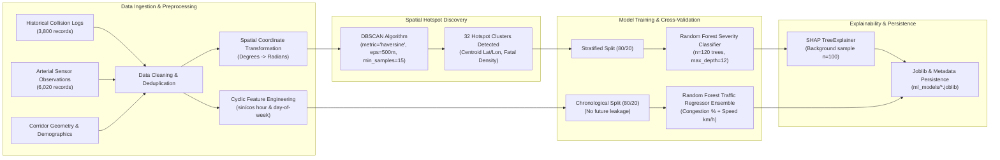

# UrbanFlow — Machine Learning & Explainable AI Pipeline

## 1. Pipeline Overview

UrbanFlow incorporates two distinct machine learning subsystems:
1. **Accident Spatial Clustering & Severity Risk Classifier (Model 1)**
2. **Arterial Traffic Congestion & Speed Forecaster (Model 2)**

Both models prioritize data integrity, avoid temporal data leakage through chronological validation splits, and implement SHAP (SHapley Additive exPlanations) for interpretability.

## 2. ML Pipeline Workflow Diagram

## 3. Evaluation Metrics Summary

| Pipeline Component | Target Variable | Algorithm | Key Metrics |
|---|---|---|---|
| Spatial Hotspots | Spatial Lat/Lon density | DBSCAN (Haversine) | 32 Hotspots Identified across Mumbai & Navi Mumbai |
| Accident Risk | Collision Severity (Slight/Serious/Fatal) | Random Forest Classifier | Weighted F1: 0.5587, Multi-class Accuracy: 55.66% |
| Traffic Congestion | Congestion Index % (0-100) | Random Forest Regressor | R²: 0.9084, MAE: 4.75% |
| Traffic Speed | Flow Velocity (km/h) | Random Forest Regressor | R²: 0.9176, MAE: 4.35 km/h |

## 4. SHAP Interpretability Methodology

UrbanFlow computes local SHAP feature attributions on every `/api/predictions/accident-risk` request using a precomputed background dataset.
The top 5 positive and negative contributors are returned to the user, illuminating why a specific coordinate or environmental configuration elevated risk (e.g., Unlit nighttime roads, monsoon waterlogging, or high speed limits).

