# UrbanFlow — System Architecture & Design Documentation

## 1. System Overview

UrbanFlow is built upon a high-performance, modern multi-tier decoupled architecture:
- **Presentation Layer**: React 19 + TypeScript + Vite + Tailwind CSS + Leaflet.js + Recharts.
- **Application & API Layer**: Python FastAPI REST service with asynchronous endpoints, Pydantic data validation, and SQLAlchemy ORM.
- **Machine Learning & Intelligence Layer**: Scikit-Learn Random Forest ensemble classifiers and regressors, DBSCAN spatial clustering with Haversine spherical distance metrics, and SHAP TreeExplainer for local feature attribution.
- **Data Persistence Layer**: PostgreSQL with PostGIS spatial extensions (with zero-configuration SQLite/SpatialLite fallback for local lightweight development).

## 2. High-Level Architecture Diagram

```mermaid
flowchart TD
    subgraph Client["Presentation Layer (Vite + React 19 + TypeScript)"]
        UI_Dash["Command Center Dashboard\n(KPIs & Severity Telemetry)"]
        UI_Map["Interactive Leaflet Map\n(Dark Matter + DBSCAN Halos)"]
        UI_Traffic["Traffic Forecaster\n(Diurnal 24h Trendlines)"]
        UI_Risk["Risk Inference & SHAP\n(Feature Sensitivity Waterfall)"]
        UI_Analytics["Analytics & Demographics\n(Diurnal & Weather Impact)"]
        UI_Data["Dataset Governance\n(Schema Validation & Ingestion)"]
    end

    subgraph Gateway["API Gateway & Reverse Proxy"]
        NGINX["Nginx / Vite Proxy (:5173 / :80)"]
    end

    subgraph Backend["Application Server (FastAPI :8000)"]
        Router_Dash["/api/dashboard"]
        Router_Acc["/api/accidents & /hotspots"]
        Router_Pred["/api/predictions/accident-risk & /traffic"]
        Router_Traf["/api/traffic"]
        Router_Anal["/api/analytics"]
        Router_Data["/api/datasets"]
        Router_Meta["/api/models"]
    end

    subgraph MLEngine["ML & Explainability Engine (Scikit-Learn & SHAP)"]
        DBSCAN_Clust["DBSCAN Spatial Clustering\n(Haversine eps=500m)"]
        RF_Classifier["Random Forest Severity Classifier\n(Weighted F1: 0.56)"]
        SHAP_Explainer["SHAP TreeExplainer\n(Feature Attributions)"]
        RF_Regressor["Traffic Congestion & Velocity Regressors\n(R²: 0.91, MAE: 4.75%)"]
    end

    subgraph Storage["Data Persistence Layer"]
        DB[(PostgreSQL 16 + PostGIS / SQLite DB)]
        Disk_Models["ml_models/*.joblib\n(Serialized Artifacts)"]
        Disk_Datasets["datasets/sample/*.csv\n(Verified Baseline Datasets)"]
    end

    Client -->|REST HTTP / JSON| NGINX
    NGINX --> Backend
    Backend --> MLEngine
    Backend --> Storage
    MLEngine --> Storage
```

## 3. Communication Protocols

1. **Client to Backend**: RESTful JSON over HTTP/2, with typed TypeScript interfaces matching Pydantic response models.
2. **Backend to ML Engine**: In-memory joblib persistence with sub-millisecond inference latency.
3. **Spatial Queries**: Haversine distance computations mapping any coordinates to nearest known accident hotspot centroids.

